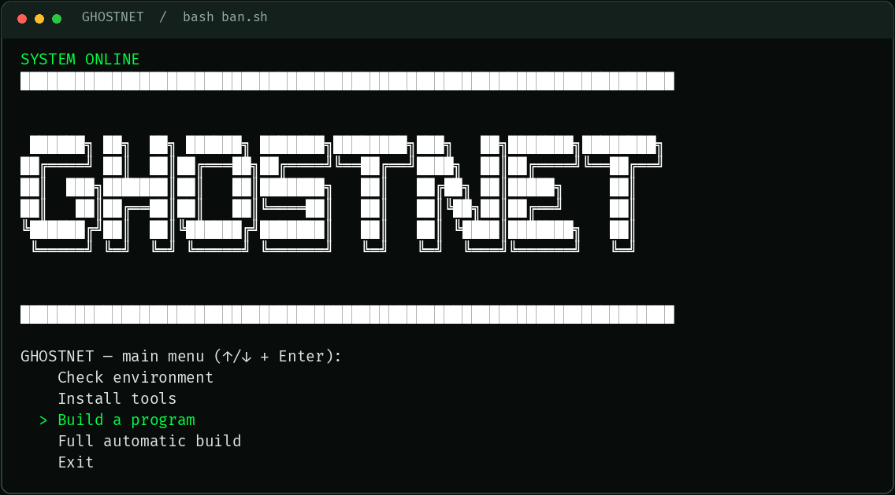
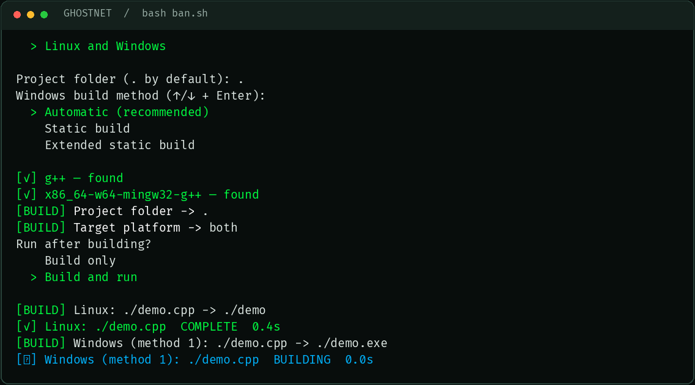
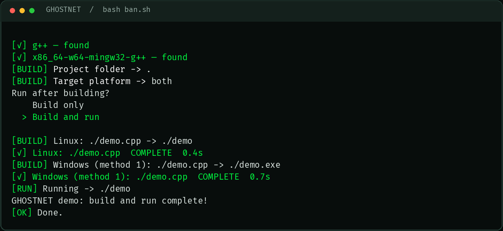

# GHOSTNET

**Терминальный инструмент для сборки отдельных программ на C++, Python и Rust.**

Терминал в духе Watch Dogs 2: зелёные сигналы, анимация процесса и меню со стрелками. Выберите проект, проверьте инструменты, соберите программу и при необходимости запустите результат.

[English](README.md) · [Русский](README.ru.md) · [Скачать релиз](https://github.com/galvatrone/CPP-Builder-Gostnet-/releases/latest)



## Скачать

Скачайте и распакуйте архив для своей системы. Каждый архив содержит независимые скрипты: английский `ban.sh` и русский `ban-ru.sh`. Для работы одного второй не требуется.

| Система | Последний релиз |
| --- | --- |
| Linux | [ghostnet-linux.zip](https://github.com/galvatrone/CPP-Builder-Gostnet-/releases/latest/download/ghostnet-linux.zip) |
| Windows с MSYS2 | [ghostnet-windows.zip](https://github.com/galvatrone/CPP-Builder-Gostnet-/releases/latest/download/ghostnet-windows.zip) |
| macOS | [ghostnet-macos.zip](https://github.com/galvatrone/CPP-Builder-Gostnet-/releases/latest/download/ghostnet-macos.zip) |
| Все платформы | [ghostnet-all-platforms.zip](https://github.com/galvatrone/CPP-Builder-Gostnet-/releases/latest/download/ghostnet-all-platforms.zip) |

Отдельные скрипты: [ban.sh](https://github.com/galvatrone/CPP-Builder-Gostnet-/releases/latest/download/ban.sh) · [ban-ru.sh](https://github.com/galvatrone/CPP-Builder-Gostnet-/releases/latest/download/ban-ru.sh).

Скрипты распространяются через GitHub Releases. Установка пакета npm или Python не требуется.

### Bash на macOS

В macOS встроен старый Bash. GHOSTNET требует **Bash 4.4 или новее**. Сначала установите Bash через Homebrew:

```bash
brew install bash
```

Используйте `ban.command` или `ban-ru.command`: они автоматически выбирают новый Bash. Для запуска из терминала: `"$(brew --prefix bash)/bin/bash" ban-ru.sh`.

## Запуск

**Linux:** откройте терминал в распакованной папке и выполните:

```bash
bash ban-ru.sh
```

**macOS:** откройте `ban-ru.command` или выполните `"$(brew --prefix bash)/bin/bash" ban-ru.sh` в Terminal. Нативная сборка создаёт исполняемые файлы macOS. Для установки инструментов используется уже установленный Homebrew. Если отсутствуют инструменты командной строки Apple, установите их командой `xcode-select --install`.

**Windows:** установите [MSYS2](https://www.msys2.org/), затем откройте `ban-ru.cmd`. Лаунчер использует среду MSYS2 **UCRT64** и по умолчанию ищет её в `C:\msys64`. Для другого расположения задайте `MSYS2_ROOT`, указав папку установки. Можно также выполнить `bash ban-ru.sh` в терминале MSYS2 UCRT64. Одних PowerShell или командной строки недостаточно: нужна среда Bash и компиляторов MSYS2.

Для английского интерфейса используйте `ban.sh`, `ban.command` или `ban.cmd`. Меню переключения языка отсутствует.

Перемещайтесь клавишами **↑ / ↓**, выбирайте пункт клавишей **Enter**. Главное меню предлагает проверку инструментов, их установку, сборку и автоматический режим проверки со сборкой. Выберите папку проекта и платформу, затем решите, запускать ли результат. Вне интерактивного терминала анимация отключается автоматически; параметр `--no-animation` отключает её явно.

## Что поддерживается

GHOSTNET обрабатывает файлы `.cpp`, `.py` и `.rs` непосредственно в выбранной папке. Каждый файл обрабатывается отдельно; вложенные папки не сканируются.

| Исходник | Действие | Результат |
| --- | --- | --- |
| `.cpp` | Компиляция по стандарту C++17 | Нативный исполняемый файл и/или Windows `.exe` |
| `.py` | Проверка через `python3 -m py_compile` | Кеш байткода Python; исходный скрипт запускается через `python3` только по запросу |
| `.rs` | Компиляция через `rustc --edition=2021` | Нативный исполняемый файл и/или Windows `.exe` |

Нативные исполняемые файлы создаются рядом с исходниками, обычно под именем исходника без расширения. Для Windows добавляется `.exe`. Если основы имён совпадают, выходные файлы получают разные имена; планирование результатов предотвращает перезапись исходников. Фактические имена видны в выводе сборки.

Инструмент предназначен для отдельных файлов. Для связывания нескольких исходников, проектов Cargo, внешних библиотек и управления зависимостями Python нужна отдельная система сборки проекта. Проверка Python проверяет синтаксис, но не упаковывает программу в исполняемый файл и не устанавливает импортируемые модули.

## Системы и цели сборки

`--target native` выбирает нативную платформу текущей системы.

| Система запуска | Допустимые цели | Значение `both` |
| --- | --- | --- |
| Linux | `native`, `linux`, `windows`, `both` | Linux + Windows |
| macOS | `native`, `macos`, `windows`, `both` | macOS + Windows |
| Windows / MSYS2 UCRT64 | `native`, `windows` | Недоступно |

Кросс-компиляция для Windows на Linux/macOS использует MinGW-w64. Сборка для Linux на macOS недоступна; Windows не поддерживает сборку для Linux или macOS. Нативный Windows `.exe` запускается напрямую. Для запуска Windows `.exe`, собранного на Linux/macOS, нужен отдельно установленный Wine.

Для кросс-компиляции Rust под Windows также нужна стандартная библиотека целевой платформы. Если инструментами управляет rustup, установите её явно:

```bash
rustup target add x86_64-pc-windows-gnu
```

GHOSTNET не устанавливает стандартные библиотеки целевых платформ Rust автоматически. Пакет `rustc` из репозитория дистрибутива может не содержать необходимую поддержку кросс-компиляции.

## Командная строка

```bash
# Проверить только инструменты для этой папки и цели
bash ban-ru.sh --check --target native ./project

# Проверить окружение и собрать для текущей системы
bash ban-ru.sh --auto --target native ./project

# Собрать и запустить (единственный результат выбирается автоматически)
bash ban-ru.sh --auto --target native --run ./project

# Linux/macOS: собрать для своей системы и Windows
bash ban-ru.sh --auto --target both ./project

# Установить недостающие инструменты с явным разрешением
bash ban-ru.sh --install-deps --target native --yes ./project
```

| Параметр | Назначение |
| --- | --- |
| `--check` | Проверить необходимые инструменты без сборки |
| `--install-deps` | Установить недостающие инструменты |
| `--auto` | Проверить инструменты, предложить установку и собрать |
| `--target TARGET` | Выбрать допустимую цель из таблицы систем |
| `--run` | Запустить один успешный результат после сборки |
| `--yes` | Разрешить установку зависимостей без дополнительного вопроса |
| `--no-animation` | Отключить анимацию терминала |
| `--help` | Показать справку |

Пути с пробелами заключайте в кавычки. Если путь проекта начинается с `-`, укажите перед ним `--`. Без `--yes` установка пакетов требует подтверждения в терминале. Для запуска без участия пользователя задайте действие, цель и папку проекта явно.

Дополнительные переменные окружения:

| Переменная | Назначение |
| --- | --- |
| `BAN_SOURCE_FILE` | Обработать один файл `.cpp`, `.py` или `.rs` вместо сканирования папки |
| `BAN_TARGET_DIR` | Папка проекта по умолчанию |
| `BAN_RUN_FILE` | Выбрать конкретный результат для `--run` |
| `BAN_WIN_METHOD` | Способ сборки C++ для Windows: `auto`, `1` или `2` |
| `BAN_NO_ANIMATION=1` | Отключить анимацию |

```bash
BAN_SOURCE_FILE=./project/main.py bash ban-ru.sh --auto --target native --run ./project
BAN_RUN_FILE=hello bash ban-ru.sh --auto --target native --run ./project
```

Если результатов несколько, интерактивный запуск предлагает меню выбора. При неинтерактивном запуске требуется `BAN_RUN_FILE`. После успешной проверки можно выбрать путь исходника Python. Ошибка сборки или запущенной программы возвращает ненулевой код завершения.

## Инструменты и установка

Проверка и установка учитывают найденные исходники и выбранную цель: для C++ нужен компилятор, для Python — `python3`, для Rust — `rustc`. Кросс-компиляция для Windows также требует компоновщик MinGW. Проверка или установка без проекта охватывает весь поддерживаемый набор инструментов.

| Система | Менеджер пакетов |
| --- | --- |
| Debian / Ubuntu | `apt-get` |
| Fedora | `dnf` |
| Arch Linux | `pacman` |
| macOS | Homebrew (`brew`) |
| Windows / MSYS2 UCRT64 | MSYS2 `pacman` с пакетами UCRT64 |

Перед установкой инструмент показывает недостающие пакеты. Установка системных пакетов Linux может требовать `sudo`. Homebrew или MSYS2 нужно установить самостоятельно до использования соответствующего сценария установки зависимостей.

## Вид терминала

Изображения созданы из настоящего терминального вывода GHOSTNET.





## Разработка

Скрипты остаются самостоятельными точками входа на Bash. [GitHub Actions](https://github.com/galvatrone/CPP-Builder-Gostnet-/actions/workflows/platforms.yml) проверяет нативную сборку C++ и Rust, проверку и запуск Python, а также лаунчеры на Linux, macOS и Windows/MSYS2. Задача Linux также проверяет кросс-компиляцию для Windows и защиту от совпадений имён выходных файлов.
